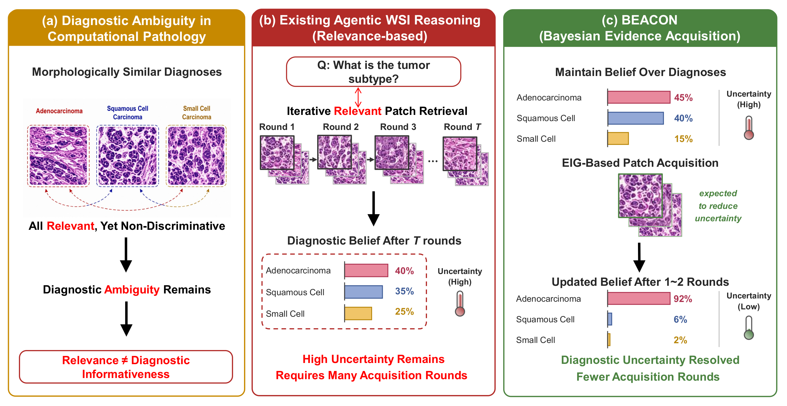
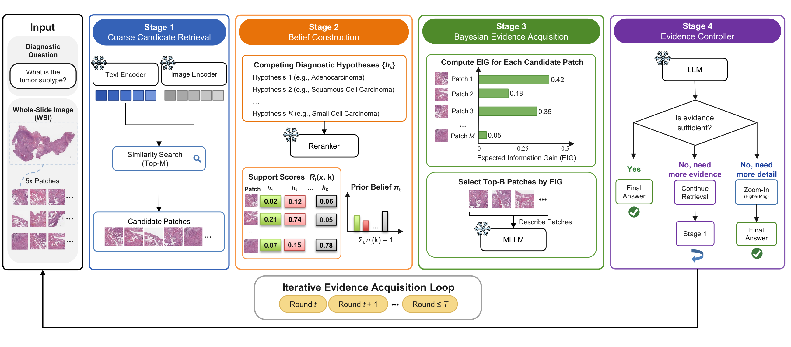

<h1 align="center">Beyond Relevance: Bayesian Evidence Acquisition for Agentic Whole-Slide Image Reasoning</h1>

<p align="center">
  <a href="https://github.com/bryanwong17/BEACON">
    
  </a>
  <a href="https://arxiv.org/abs/2608.05757">
    
  </a>
  <a href="https://arxiv.org/pdf/2608.05757">
    
  </a>
</p>

## 📣 Updates

* **2026.08.06** — Released the initial code.

## 🚀 Overview

We propose **BEACON**, a **training-free, plug-and-play** agentic framework for gigapixel whole-slide image visual question answering (WSI-VQA) that reformulates WSI reasoning as a **Bayesian evidence acquisition** problem, maintaining a probabilistic belief over competing diagnostic hypotheses and acquiring patches by **expected information gain (EIG)** rather than semantic relevance.

<p align="center">
  
</p>

### Why BEACON?

- WSIs are **gigapixel in scale**, so an agent must **decide which patches to inspect** before it can answer a diagnostic question.
- Existing agentic frameworks assume semantically relevant patches are diagnostically informative, but competing diagnostic hypotheses often look alike, so **relevant patches are often not diagnostically informative**.
- Relevance-driven retrieval can therefore waste its acquisition budget on redundant patches, without actually **reducing diagnostic uncertainty**.

### Key Contributions

- We formulate patch acquisition in agentic WSI reasoning as a **Bayesian evidence acquisition** problem: maintaining a belief over competing diagnostic hypotheses and acquiring evidence to **reduce diagnostic uncertainty**.
- We propose **BEACON**, a **training-free**, **plug-and-play** agentic framework that performs **uncertainty-aware** patch acquisition by combining Bayesian belief estimation with expected information gain (EIG).
- Across five zero-shot WSI-VQA benchmarks and diverse foundation-model backbones, BEACON achieves the **strongest overall performance** among training-free agentic frameworks while requiring substantially fewer acquisition rounds.

<p align="center">
  
</p>


### How BEACON Works

1. **Coarse Candidate Retrieval**: a pathology VLM narrows the search space to a compact candidate pool based on the current retrieval query.
2. **Belief Construction**: estimates a probabilistic belief over competing diagnostic hypotheses from the retrieved candidates.
3. **Bayesian Evidence Acquisition**: scores candidates by expected information gain (EIG) and selects the patches expected to reduce diagnostic uncertainty the most.
4. **Evidence Control**: decides whether the accumulated evidence is enough to answer, whether to keep exploring, or whether higher-resolution inspection is needed.

## 🛠 1. Installation

```bash
git clone https://github.com/bryanwong17/BEACON.git
cd BEACON

conda env create -f environment.yml
conda activate beacon

pip install --no-deps git+https://github.com/Mahmoodlab/CONCH.git
pip install --no-deps git+https://github.com/aldraus/quilt-llava.git
```

## 2. Data Preparation

Download MultiPathQA slides: see [GIANT: Downloading MultiPathQA Slides](https://github.com/KianWeihrauch/GIANT#-downloading-multipathqa-slides).

Next, arrange the data into a data root with one folder per dataset (`tcga_slidebench`, `tcga_expert_vqa`, `tcga`, `gtex`, `panda`), laid out like this:

```text
DATA_ROOT/
└── tcga_slidebench/
    ├── desc/patches_descriptions.json
    ├── img_features/
    │   ├── slide_a.npy
    │   └── ...
    └── patches_output/
        ├── slide_a/
        │   ├── 0_23904.png
        │   └── ...
        └── ...
```

- **`patches_output/`** (5x image patches): see [PathAgent: Section 2.1 (Patch Generation)](https://github.com/G14nTDo4/PathAgent#21-patch-generation).
- **`desc/patches_descriptions.json`** (offline 5x patch descriptions): see [PathAgent: Section 2.2 (Description Generation)](https://github.com/G14nTDo4/PathAgent#22-description-generation).
- **`img_features/`** (precomputed 5x VLM embeddings; saved as `img_features_conch/` when `VLM_BACKEND=conch`).

Separately, download model checkpoints and place them under a `MODELS_ROOT/` of your choice:

  | Model | Hugging Face |
  |---|---|
  | PLIP | [vinid/plip](https://huggingface.co/vinid/plip) |
  | CONCH | [MahmoodLab/CONCH](https://huggingface.co/MahmoodLab/CONCH) |
  | Patho-R1-7B | [WenchuanZhang/Patho-R1-7B](https://huggingface.co/WenchuanZhang/Patho-R1-7B) |
  | PathGen-LLaVA | [jamessyx/PathGen-LLaVA](https://huggingface.co/jamessyx/PathGen-LLaVA) |
  | Qwen3-Reranker-4B | [Qwen/Qwen3-Reranker-4B](https://huggingface.co/Qwen/Qwen3-Reranker-4B) |
  | Qwen3-4B | [Qwen/Qwen3-4B](https://huggingface.co/Qwen/Qwen3-4B) |

To extract precomputed 5x VLM embeddings:

```bash
  export DATA_ROOT=/path/to/your/data/root
  export MODELS_ROOT=/path/to/your/models/root

  export VLM_BACKEND=plip           # plip, conch
  export DATASETS=tcga_slidebench   # tcga_slidebench, tcga_expert_vqa, tcga, gtex, panda

  bash run_extract_img_features.sh
```

## 3. Inference

```bash
export DATA_ROOT=/path/to/your/data/root      # data root from Section 2
export MODELS_ROOT=/path/to/your/models/root  # folder containing all model checkpoints

export VLM_BACKEND=plip           # plip, conch
export DATASETS=tcga_slidebench   # tcga_slidebench, tcga_expert_vqa, tcga, gtex, panda
export PERCEPTOR=patho_r1         # patho_r1, pathgen_llava, gpt5
export EVIDENCE_CONTROLLER=qwen   # qwen, gpt5

export RERANKER_CKPT=$MODELS_ROOT/Qwen3-Reranker-4B

export PATHO_R1_CKPT=$MODELS_ROOT/Patho-R1-7B           # if PERCEPTOR=patho_r1
# export PATHGEN_LLAVA_CKPT=$MODELS_ROOT/PathGen-LLaVA  # if PERCEPTOR=pathgen_llava

export QWEN_CKPT=$MODELS_ROOT/Qwen3-4B                  # if EVIDENCE_CONTROLLER=qwen

# if PERCEPTOR or EVIDENCE_CONTROLLER is gpt5, also export:
# export OPENROUTER_API_KEY=sk-or-v1-...
# export OPENROUTER_BASE_URL=https://openrouter.ai/api/v1

bash run_beacon.sh
```

Results are written to `results/BEACON_<VLM>_M<M>_B<B>_reranker_qwen3-<size>_perceptor_<perceptor>_controller_<controller>/multipathqa_<dataset>/`.

## 4. Evaluation

To avoid format-dependent mismatches and ensure consistent evaluation, we use an LLM-based evaluator (Qwen3-4B) to infer the intended answer choice.

```bash
export MODELS_ROOT=/path/to/your/models/root  # same root as Section 3

export DATASETS=tcga_slidebench  # tcga_slidebench, tcga_expert_vqa, tcga, gtex, panda
export BASE_DIR=results/BEACON_PLIP_M25_B5_reranker_qwen3-4B_perceptor_Patho-R1-7B_controller_Qwen3-4B  # results directory from Section 3

export QWEN_CKPT=$MODELS_ROOT/Qwen3-4B

bash run_eval.sh
```

Results are written to `$BASE_DIR/multipathqa_<dataset>/eval_summary.json`.

ACC is reported for `tcga_slidebench` and `tcga_expert_vqa`.
BACC is reported for `tcga`, `gtex`, and `panda`.

## Citation

If you find our work useful in your research, please consider starring 🌟 this repo and citing our [paper](https://arxiv.org/abs/2608.05757) at:

```
@article{wong2026beacon,
  title={Beyond Relevance: Bayesian Evidence Acquisition for Agentic Whole-Slide Image Reasoning},
  author={Wong, Bryan and Xu, Xun and Fu, Huazhu and Chen, Nancy F. and Yi, Mun Yong},
  journal={arXiv preprint arXiv:2608.05757},
  year={2026}
}
```

## Acknowledgements

This project is based on [PathAgent](https://github.com/G14nTDo4/PathAgent), [GIANT](https://github.com/KianWeihrauch/GIANT/tree/main?tab=readme-ov-file), [PLIP](https://github.com/PathologyFoundation/plip), [CONCH](https://github.com/mahmoodlab/CONCH), [Patho-R1](https://github.com/wenchuan-zhang/patho-r1), [PathGen-LLaVA](https://github.com/PathFoundation/PathGen-1.6M), and [Qwen](https://github.com/QwenLM). We sincerely thank the authors of these excellent works.

## Contact

If you have any questions, feedback, or issues regarding this project, please reach out via email at [bryan.wong@kaist.ac.kr](mailto:bryan.wong@kaist.ac.kr) or open an issue on GitHub.
